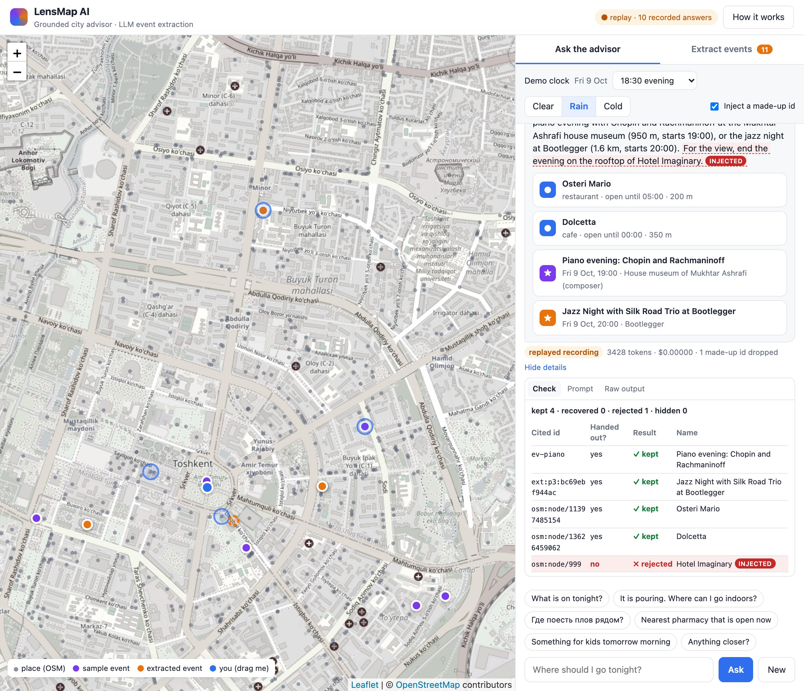
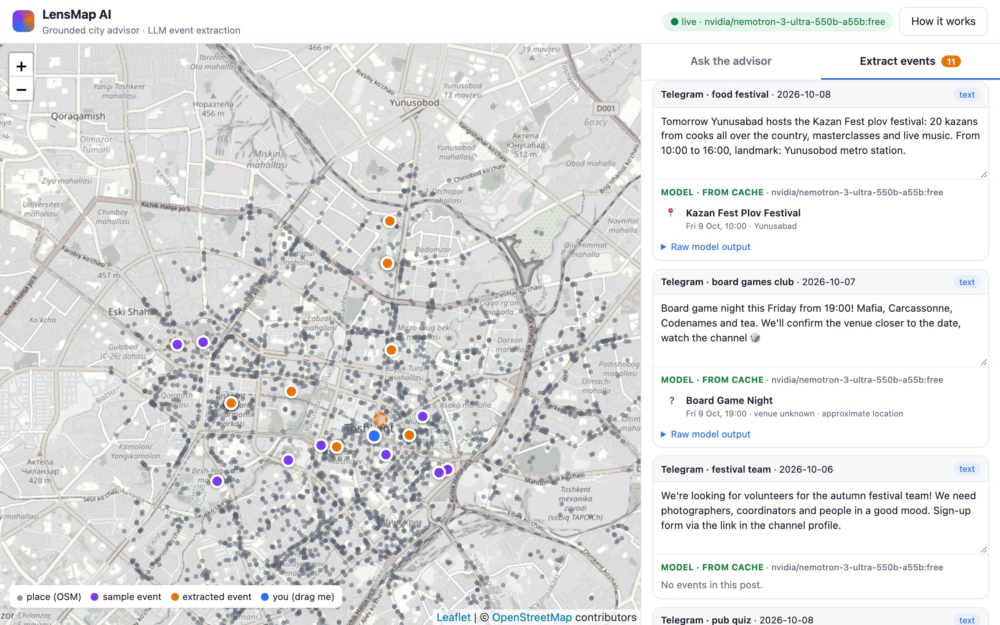
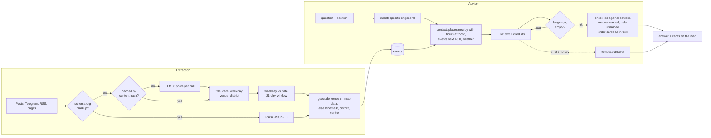

# LensMap AI — grounded city advisor and LLM event extraction

Two AI features from [LensMap](#origin), a Flutter city map app I built, extracted into a demo that runs
on a laptop in one command:

- **A city advisor that answers from map data.** It answers "where should I go tonight?" from
  OpenStreetMap places, events and the weather, returns the ids of everything it recommends, and
  the server checks every id against the data it handed out before a card is shown.
- **An LLM pipeline that turns messy announcements into events on a map.** Telegram-style posts
  (English here; Russian and Uzbek work too) go to the model in batches; pages with schema.org markup are parsed
  without it; coordinates always come from map data, never from the model.



*Rain, 18:30, replayed recording. The model recommends Osteri Mario, Dolcetta, the piano evening and
the jazz night at Bootlegger (an extracted event), and all four ids check out. With **Inject a
made-up id** on, the demo appends "Hotel Imaginary" (`osm:node/999`) to the answer as if the model
had invented it, before the check runs: the id was never handed out, so it is rejected and gets no
card. The sentence stays in the text, marked as injected.*

## What to look at

| In the demo | Why it matters in production |
| --- | --- |
| **Inspect → Check** under every answer: one row per id, whether the server handed it out in this request, and the result: kept, recovered by name (named but not cited), rejected (made up), hidden (cited but never mentioned) | Hallucinated or irrelevant recommendations never reach the user, and you can see when the model misbehaves |
| Tick **Inject a made-up id** and ask again | None of the recorded answers invents an id, so the demo can add one (`osm:node/999`, "Hotel Imaginary") to the model output before the check: it is rejected, gets no card, and is labelled as injected |
| Change the **demo clock** to 23:30 or the **weather** to rain and ask again | Opening hours and weather are evaluated on the server and given to the model as facts |
| Ask in another language (Russian, say), follow up with "anything closer?" | The answer must come back in the language of the question; a wrong-language answer is retried once, then replaced by a template |
| **Extract events** tab: "this Friday", "this Sunday", a district without a venue, a recruiting post | Weekdays named in the post are checked against the model's date, junk is skipped, uncertain locations are marked as approximate |
| The ticketing page in the extraction tab | Structured data is read without a model call: cheaper and exact |
| Run without an API key | Recorded answers are replayed; anything else gets a template answer over the same context instead of an error |



*The plov festival "in Yunusabad, near the metro" matches a venue named Yunusabad on the map (a
sports ground, `osm:way/86487001`) and gets an exact point (the pin icon), a board-game night with no
venue goes to the city centre and is marked approximate, a call for volunteers yields no events.*

## Run it

Node 20.12 or newer.

```bash
npm install
npm start            # http://127.0.0.1:4310
```

Out of the box the demo replays recorded answers for the preset questions and the sample posts
(a preset question starts a new conversation, so its recording matches). For live answers add an
[OpenRouter](https://openrouter.ai) key, or point it at a local model:

```bash
cp .env.example .env   # put OPENROUTER_API_KEY in it
npm start

# or fully local, nothing leaves the machine (Ollama)
LLM_BASE_URL=http://localhost:11434/v1 LLM_MODEL=qwen2.5:7b npm start
```

`LLM_MODEL` picks the model (a free one by default). Paid models are refused unless
`ALLOW_PAID_MODELS=1`. Any OpenAI-compatible endpoint works through `LLM_BASE_URL`. Behind a reverse
proxy set `TRUST_PROXY=1` so the per-IP rate limit sees the client address.

### Keyless deployments: record once, replay forever

```bash
npm run record   # answers the preset questions and extracts the sample posts with the live model
```

Answers are stored under a hash of the exact request (model included) in `data/llm-cache.json` and
`data/extract-cache.json`. A server without a key replays them for the same requests and labels them
"replayed recording" with the model's name; anything else falls back to the template. Live answers
are recorded too, so repeated questions cost nothing.

The bundled recordings were made with **`nvidia/nemotron-3-ultra-550b-a55b:free` on OpenRouter**, a
reasoning model: it thinks for a few thousand tokens before answering, so extraction gets an 8,000-token
budget and `LLM_REASONING_EFFORT=low`. Small local models still work (`EXTRACT_BATCH=2` helps a 7B
model read posts), and the inspector shows where the server had to correct them.

```bash
npm test             # unit tests: parsing, name matching, verification, date checks, opening hours
npm run typecheck
npm run screenshots  # regenerates docs/*.jpg with headless Chrome (demo must be running)
```

## How it works



### Decisions worth noting

- **The model chooses, the server knows.** Every place and event in the prompt carries an id and
  the model must return the ids it used. Ids that are not in the context are dropped; decorated
  ones (`id=osm:node/1`, a bare number) are cleaned up only when the match is unambiguous. A place
  named in the text without an id is matched by name on word boundaries, across Cyrillic, Uzbek
  Latin and English spellings (`src/names.ts`). A cited place the text never mentions gets no card.
- **Facts are computed, not generated.** Distances, "open until 22:00", the 48-hour event window and
  the weather are prepared by code. For a specific question, places open now come first, places
  named after the request ("plov") come before nearer ones, and unknown hours are stated as such.
- **Output guards.** An empty answer, an answer in another script or in the wrong language is sent
  back once with a stricter instruction, then replaced by the template. Ids never leak into the
  text the user reads.
- **Small-model date errors are caught by redundancy.** The prompt carries a calendar, the model
  also returns the weekday, and the server checks the date against the weekday the post itself
  names ("this Friday", or "yakshanba" in an Uzbek post). On a mismatch the post wins.
- **Coordinates never come from the model.** Extraction returns the venue as written in the post;
  the geocoder finds it on map data (a generic word such as "museum" must match the category, a
  street name is never taken for a venue, a chain with many branches is marked approximate), then
  tries the district, a landmark, and finally a known venue written in the original text. If only a
  district is known, the event goes there with a stable offset and an "approximate" mark; if
  nothing is known, to the city centre, not to the user.
- **Structured first.** schema.org events are parsed directly; the model only reads free text.
- **Fail-soft and cost guards.** Any LLM error returns `{ ok: false }` and a fallback takes over.
  Paid models are opt-in, live calls are rate-limited per IP, every answer shows latency, tokens and
  cost, and recordings make repeat questions free.
- **The configured model is checked at startup** against the provider's model list. This came from
  production: the free model LensMap used was retired upstream and the advisor failed until the name
  was changed.

## Data

`data/city.json` is a snapshot of 3,036 named places and 415 districts in central Tashkent from
OpenStreetMap (© OpenStreetMap contributors, ODbL). Rebuild it, or build another city, with:

```bash
npm run fetch-city -- --city Lisbon --lat 38.7106 --lng -9.1393 --tz Europe/Lisbon
```

Events in `data/events.json` and posts in `data/posts.json` are **synthetic sample data** placed at
real venues. The demo runs on a fixed date (`DEMO_DATE`, Friday 9 October 2026) so that sample
events never drift into the past and recorded answers stay valid.

## Origin

LensMap is a social city map: friends' posts, places and events on one map, plus a city layer
collected automatically from open data, venue websites and Telegram channels. Flutter client
(about 37k lines of Dart) and a self-hosted Node + TypeScript backend (Fastify, PostgreSQL, a
crawler worker). This demo ports its advisor (`routes/advisor.ts`) and event extraction
(`citypulse/extract.ts`) with an in-memory dataset instead of PostgreSQL and the live crawlers, and
adds the inspector, the output guards and the weekday check.

## Layout

| Path | Contents |
| --- | --- |
| `src/advisor.ts` | Context building, prompt, output guard, verification of cited ids, template fallback |
| `src/extract.ts` | Prompt with calendar, batching, per-post cache, weekday check, validation, geocoding |
| `src/llm.ts` | OpenAI-compatible client: fail-soft, paid-model guard, model check, record/replay |
| `src/names.ts` | Cross-script name matching used by the geocoder and the advisor |
| `src/geocode.ts` | Venue, landmark, district and in-text geocoding over the snapshot |
| `src/jsonld.ts` | schema.org Event parser |
| `public/` | The UI: Leaflet map, chat with inspector, extraction tab |
| `scripts/` | `fetch-city.ts` (OSM snapshot), `record.ts` (recordings), `screenshots.ts` (README images) |

## License

Code: MIT, see [LICENSE](LICENSE). The city snapshot in `data/city.json` and the map tiles are
© OpenStreetMap contributors, available under the [Open Database License](https://www.openstreetmap.org/copyright).
The sample events and posts are made up for the demo.
